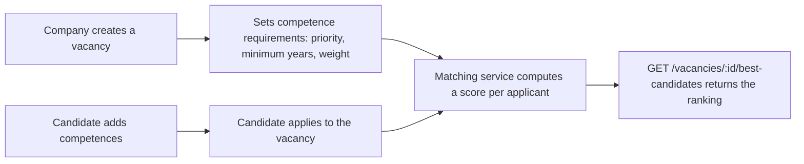

# Seleto — Backend

Recruitment and selection platform (ATS) API. Companies open vacancies, define the hiring process as configurable steps, and rank applicants with a weighted candidate–vacancy match score.

> 🇧🇷 **Resumo:** Seleto é o meu Trabalho de Graduação (TG, 2025): uma plataforma de recrutamento e seleção. Este repositório é o backend (NestJS). O frontend, feito com [Jonas Moura](https://github.com/jonasmouradev), está em [seleto-frontend](https://github.com/Gmendesfonseca/seleto-frontend). O projeto agora é a base de uma plataforma que evolui: cada migração (monólito → serviços, versões, bancos, nuvem) fica registrada abaixo, com ADR e métricas de antes e depois.

## What it does

- **Vacancies and hiring steps.** Recruiters define a vacancy, its requirements, benefits and responsible people, and build the process from reusable steps and vacancy templates.
- **Applications funnel.** Candidates apply; recruiters move them through the vacancy's steps.
- **Candidate–vacancy matching.** A weighted score ranks applicants: competences 40%, experience 25%, education 15%, location 10%, salary 10%. Competence requirements carry a priority (required, preferred or nice_to_have), a minimum number of years and a weight, and proficiency levels map to points.
- **Multi-company access control.** Users, companies, roles and permissions (RBAC), with JWT access tokens, refresh tokens and password reset.
- **Dashboard** with recruitment indicators.
- **i18n** in Portuguese and English.

## The problem

Recruiters usually screen applicants by hand: they open each profile and compare it against the vacancy's requirements one by one. Seleto lets the company state those requirements as weighted competences (priority, minimum years, weight) and ranks every applicant against them. The recruiter opens a sorted list instead of a pile of profiles.

## How it works



Priority is one of `required`, `preferred` or `nice_to_have`.


## API docs

- Swagger UI is served at `/docs` when the API is running (outside the `api/v1` prefix).
- `openapi.json` is committed at the repo root. CI runs `npm run openapi:check`, which regenerates it and `src/metadata.ts` and fails if either differs from what is committed.

## Try it

With the API running on the default port 5000:

```bash
DEMO_PASSWORD=choose-a-password API_URL=http://127.0.0.1:5000/api/v1 npm run demo:seed
```

The script uses only public endpoints. It creates (or reuses) a demo company account, six global competences, and a "Senior Backend Engineer" vacancy with five weighted competence requirements. It then registers five candidate accounts with different skill levels, has each one apply, and prints the vacancy's ranking from `best-candidates`. Re-running it tolerates existing accounts and competences but creates a new vacancy each time.

## Architecture

A modular NestJS monolith. Each business area under `src/domain/` (vacancies, steps, applications, matching, competences, companies, users, auth, roles, permissions, …) owns its controller, service, DTOs and repositories behind interfaces, so persistence can be swapped without touching business rules.

| Concern | Choice |
|---|---|
| Runtime | Node.js, NestJS 11 (SWC builder) |
| Relational data | PostgreSQL 15 via Sequelize, versioned migrations in `migrations/` |
| Cache / queue | Redis 7; Bull module wired but no queue consumers yet |
| Protection | Global rate limiting (Nest throttler guard), guard-based authorization |
| Ops | Health check module, Docker Compose for local stack |

## Running locally

```bash
docker compose up -d      # postgres:5432, redis:6379, mongo:27017, api:5000
cp .env.example .env      # fill in local values
npm ci
npm run migrate
npm run start:dev
```

Tests:

```bash
npm test                  # unit
npm run test:e2e          # end-to-end (auth, users, companies, applications)
```

## Known gaps (tracked for the next milestone)

- `DELETE /persons/:id/competences/:competenceId` has no ownership check.
- Who may create global competences is undefined: any authenticated user can.
- `GET /competences` is not paginated.
- A concurrent duplicate competence name returns 500 instead of 409.
- Signup with a duplicate CNPJ returns 500 instead of 409, and signup is not transactional (it can leave an orphan user).
- `POST /applications` trusts `applicantId` from the body.
- `GET /vacancies/:id/best-candidates` and `GET /vacancies/:id` are not tenant-scoped.
- `CompanyContextMiddleware` trusts a request header for the company.
- `/health` requires auth.
- The permission, role and vacancy-template models declare `created_at`/`updated_at` columns, which causes notNull errors on insert.

## Known gaps (v1 baseline)

This is the honest v1 baseline the evolution log starts from:

- No OpenAPI/Swagger contract (added in the 2026-11 OpenAPI milestone, see the log).
- CI workflow exists (`.github/workflows/ci.yml`) but is disabled on the repository for now.
- MongoDB is provisioned in `compose.yaml` but not used by the code yet.
- The Bull queue module is configured, but no queue is registered or consumed yet.
- End-to-end specs mount controllers with mocked services; there is no end-to-end run against a real database yet.
- Auth hardening is pending: access and refresh tokens share a secret and payload, password-reset secrets do not expire, and forgot-password reveals whether an email exists.

## Evolution log

| Date | Change | Why | Before → after |
|---|---|---|---|
| 2025 | v1: modular monolith delivered as graduation project | — | baseline |
| 2026-11 | Green baseline: typecheck, lint, unit and e2e fixed; CI workflow added | SWC builds skipped type checking, so errors piled up unseen | 183 type errors → 0; unit 8/9 suites failing → 22/22 (174 tests); e2e 25/25 suites failing → 24/24 (556 tests) |
| 2026-11 | OpenAPI contract, global competences, person-competence endpoint, vacancy applications/stats endpoints, demo seed | Matching needed real competence data and a documented, CI-checked API to be demonstrable | no contract → `openapi.json` checked in CI by `openapi:check`; `npm run demo:seed` builds a ranked demo vacancy |

Planned direction: [`docs/MICROSERVICES_ROADMAP.md`](docs/MICROSERVICES_ROADMAP.md).

## Credits

Backend by Gabriel Mendes Fonseca, with contributions from Jonas Moura. Frontend by Jonas Moura and Gabriel Mendes Fonseca.
